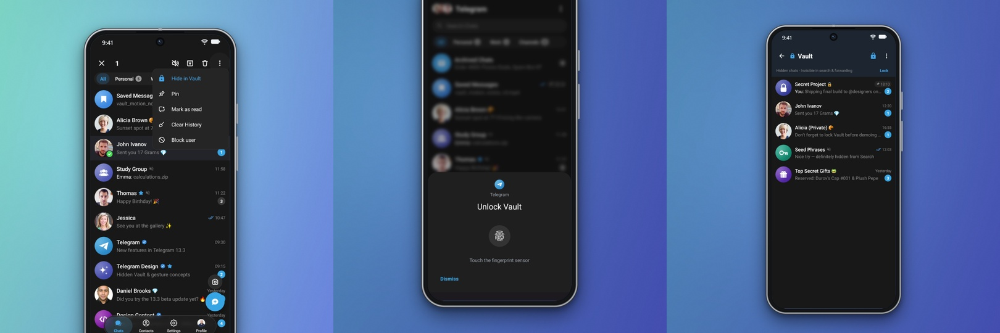

# Telegram Hidden Vault («Second Bottom» inside Archive)

A native Android UI & privacy feature concept built in pure Kotlin (`Views` + `Canvas` + `SpringAnimation` + `RenderEffect` + `BiometricPrompt`, zero third-party UI libraries), faithfully matching **Telegram Android 13.3**.



## Concept Overview

Privacy-sensitive chats shouldn't live behind an obvious padlock icon on the main screen. **Hidden Vault** sits invisibly behind **Archived Chats** as a literal *"second bottom"*:

1. **Hide any chat cleanly:** Long-press a chat to enter Telegram 13.3 Selection Mode (green avatar checkmark + ActionMode top bar `✕ · Mute · Archive · Delete · ⋮`), open `⋮`, and tap **Hide in Vault**.
2. **Pull down for Archive (100% unchanged):** Pulling down the chat list behaves identically to Telegram 13.3 — revealing **Archived Chats** with the vertical capsule arrow and flood ripple. Tapping it opens regular Archived Chats.
3. **Hold Archive -> Biometric -> Vault:** Long-pressing the **Archived Chats** row triggers haptic confirmation, blurs the background with GPU `RenderEffect`, and presents a biometric prompt to unlock the hidden **Vault**.
4. **Zero leakage, notifications & auto-lock:**
   - **While Vault is locked:** zero system push notifications, no sound/vibration, no heads-up banners, no lock-screen previews, and Vault chats are completely excluded from **Search Chats**, forwarding/share targets, folder counters, and the app icon unread badge.
   - **While Vault is unlocked:** hidden chats retain their own unread badges and previews strictly inside the `Vault` view.
   - **Instant auto-lock:** leaving the app (`onStop()`) or tapping **Lock** immediately collapses and re-locks the Vault.
   - **Production notification option:** designed so `NotificationsController` defaults to full suppression while locked, with an optional *"Silent anonymous alert"* mode (`"New activity"` without sender or message text).

## Demo Media & APK

- **Showcase video (1080×1080, 60fps):** [Watch / Download `vault-showcase.mp4`](https://github.com/zed712969-crypto/telegram-hidden-vault/raw/main/Media/vault-showcase.mp4)
- **Installable Android APK:** [Download `TelegramVault-demo.apk` (7.3 MB)](https://github.com/zed712969-crypto/telegram-hidden-vault/raw/main/Media/TelegramVault-demo.apk)

> **Note:** GitHub's mobile app previews raw repository files as text; use the direct download links above (or open in a mobile browser).

## Architecture & Key Files

- [`MainActivity.kt`](app/src/main/kotlin/com/tgdesign/vault/ui/MainActivity.kt) — Telegram 13.3 shell, Selection ActionMode, anchored `⋮` popup menu, Archive hold-to-Vault trigger, privacy-filtered search, and `onStop()` auto-lock.
- [`GlassBottomBarView.kt`](app/src/main/kotlin/com/tgdesign/vault/ui/GlassBottomBarView.kt) — Floating frosted Liquid Glass bottom navigation bar with live API 31+ `RenderNode` + `RenderEffect` backdrop blur and spring-driven lens highlight.
- [`TwoStageVaultLayout.kt`](app/src/main/kotlin/com/tgdesign/vault/ui/TwoStageVaultLayout.kt) — Spring-physics pull-down-for-archive container with custom Canvas vertical capsule arrow and expanding flood ripple.
- [`ChatAdapter.kt`](app/src/main/kotlin/com/tgdesign/vault/ui/ChatAdapter.kt) — 72dp `DialogCell` metrics, verified/premium/status/muted badges, top-line pinned pills, and avatar green selection checkmarks.
- [`RecordableBiometricSheet.kt`](app/src/main/kotlin/com/tgdesign/vault/ui/RecordableBiometricSheet.kt) — In-window Material 3 biometric sheet with animated fingerprint-to-checkmark morph (system `BiometricPrompt` is also wired behind `useSystemBiometricPrompt` in `MainActivity.kt`).
- [`TelegramIntegration/android/INTEGRATION.md`](TelegramIntegration/android/INTEGRATION.md) — Drop-in integration guide for upstream [`TelegramMessenger/Telegram-Android`](https://github.com/TelegramMessenger/Telegram-Android) (`DialogsActivity`, `MessagesController`, `PasscodeController`).

## Build from Source

```bash
./gradlew assembleDebug
```
